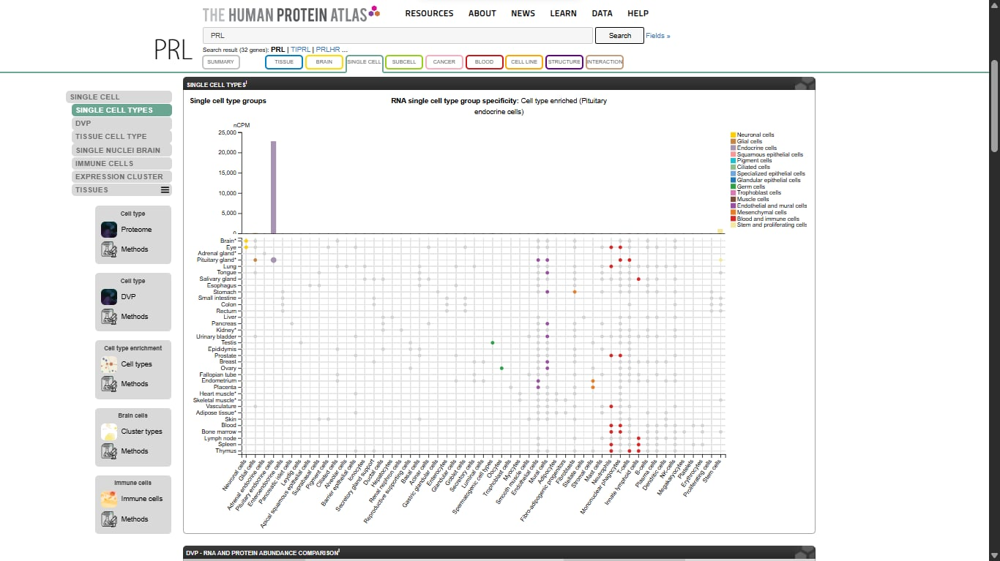
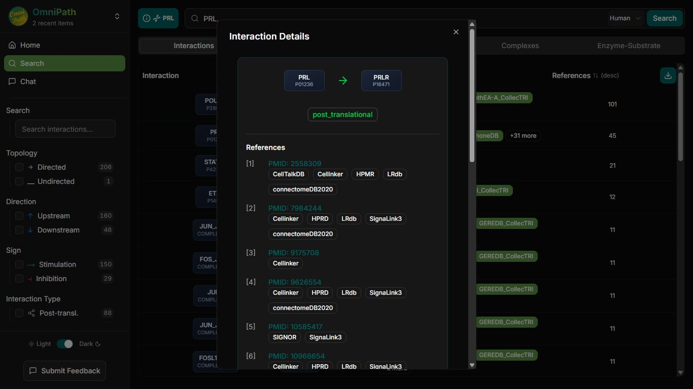
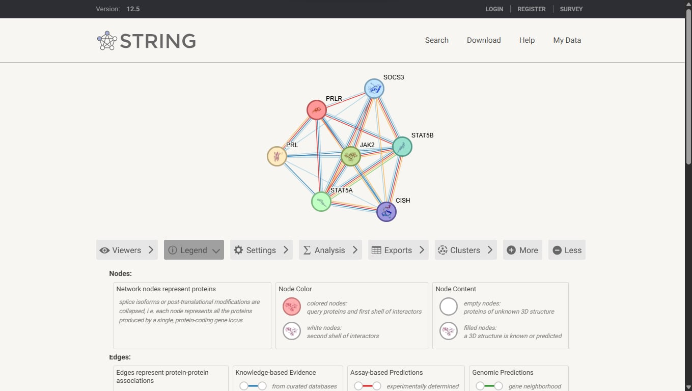
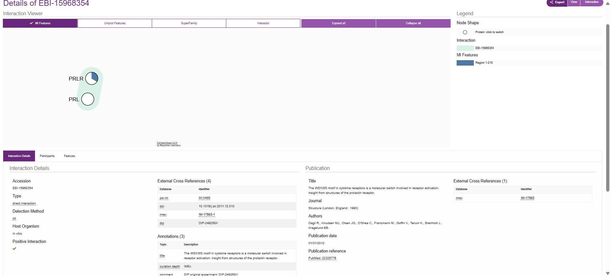
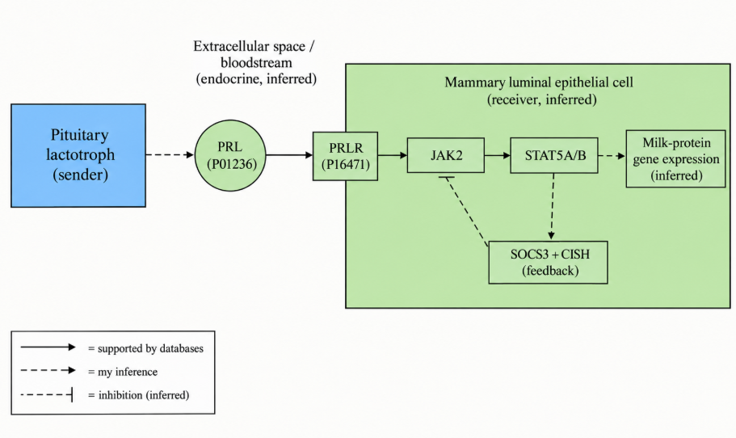

# Cell-to-Cell Communication: Pituitary Lactotroph to Mammary Luminal Epithelial Cell via Prolactin

**Individual bioinformatics laboratory (human only).**
Databases used: Human Protein Atlas (HPA), OmniPath, STRING, IntAct, UniProt (supporting).

## Repository contents
```
Cell_cell_communication/
  README.md
  Figures/
    01_sender_cell_evidence.png
    02_omnipath_evidence.png
    03_string_network.png
    04_intact_evidence.png
    05_final_model.png
  Data/
    interaction_summary.csv
```

## 1. Title and biological question

**Question:** How can prolactin (PRL) made by pituitary lactotrophs signal to mammary luminal epithelial cells, which parts of this route are supported by public databases, and which parts are my own inference?

**Summary sentence:** The pituitary lactotroph produces PRL, which can signal through the prolactin receptor (PRLR) on the mammary luminal epithelial cell in the context of lactation.

**Pathway:** sender cell -> ligand -> receptor -> receiver cell -> protein network -> response.

**How to read this report:** "Database observation" means something I saw directly in a database. "Inference" means my own biological reasoning. Database presence is evidence, not proof that signaling occurs in my chosen cells.

## 2. Chosen sender cell and biological context

**Sender cell:** pituitary lactotroph (anterior pituitary gland).

**Context:** lactation and reproductive physiology. Lactotrophs are hormone-secreting endocrine cells, so they are a biologically meaningful sender of a peptide hormone that acts on distant tissue.

## 3. Candidate ligand and evidence for sender-cell expression

**Ligand:** PRL (prolactin), UniProt P01236.

**Database observations (HPA, single-cell type view):**
- PRL is annotated as a secreted protein.
- RNA is cell-type enriched in pituitary endocrine cells (Tau specificity 0.95, about 22,000 nCPM).
- Protein-level evidence is reported.



**Limit:** expression shows that the sender cell can make PRL. It does not prove that this signal reaches or acts on my chosen receiver cell.

## 4. Receptor and receiver cell with supporting evidence

**Receptor:** PRLR (prolactin receptor), UniProt P16471.
**Receiver cell:** mammary luminal epithelial cell.

**Database disagreement (reported, not hidden):** HPA's strongest PRLR signal is not mammary. HPA shows PRLR as enhanced in choroid plexus, parathyroid and placenta. The tallest single-cell bar is ciliated cells in brain, and breast luminal cells are lower. I still chose the mammary luminal cell because the PRL response there is best documented in the literature. I consider that literature stronger evidence for the *biology* of this signaling route, but HPA expression does not by itself support the choice, so the receiver choice remains my **inference**.

**Literature support for PRLR signaling in mammary epithelium** (mostly mouse and cell-line studies, so human relevance is assumed rather than shown here):
- Hynes et al. 1997 review: PRLR is associated with JAK2, and JAK2 phosphorylates STAT5, which drives beta-casein gene expression in mammary epithelial cells.
- A 2020 review in Frontiers in Cell and Developmental Biology (doi:10.3389/fcell.2020.604896) describes the JAK2-STAT5 pathway as central to mammary epithelial proliferation, differentiation and milk production.
- A mouse study of Stat5 inactivation in mammary epithelium (PMC515028) reports that Stat5 is activated by prolactin and is required for mammary epithelial proliferation and differentiation during pregnancy.

## 5. OmniPath findings



- **PRL -> PRLR:** annotated as a ligand-receptor pair with 45 references (CellPhoneDB, CellChatDB, CellCall and 31 others; PMIDs 2558309, 7984244, 9626554).
- **PRLR -> JAK2:** 10 references.
- **JAK2 -> STAT5A:** 47 references.
- **Excluded rows:** POU1F1, STAT5A, ETS1, JUN and FOS rows for PRL are regulators of *PRL expression* in the sender, so they are not part of my receiver pathway.
- **SOCS3 and CISH:** OmniPath shows stimulation arrows. These proteins are classically feedback inhibitors, so I report the arrows as observed and treat the inhibitory feedback role as an inference supported by literature (see section 6).

**Limit:** OmniPath is an integrated knowledge base and is not specific to one cell type. I verified sender-cell expression (HPA) and receiver-cell plausibility (literature) separately.

## 6. STRING network interpretation



**Network (Homo sapiens):** 7 proteins (PRL, PRLR, JAK2, STAT5A, STAT5B, SOCS3, CISH), 21 edges, with JAK2 as the central hub.

**How I chose these proteins:** I started from PRL and PRLR and added proteins from my OmniPath results and from my knowledge of the classical PRL-JAK2-STAT5 pathway. I chose them with prior assumptions, not through an unbiased search.

**Enriched processes:**
- GO:0046425, regulation of JAK-STAT cascade (FDR 8.4e-08)
- GO:0007595, lactation (FDR 9.6e-07)
- GO:0030879, mammary gland development (FDR 6.6e-07)

**Proteins most relevant to connecting receptor to response:**
- **JAK2:** kinase associated with PRLR, the central hub.
- **STAT5A and STAT5B:** transcription factors activated downstream of JAK2, linked to lactation.
- **SOCS3 and CISH:** possible negative feedback regulators. Literature supports this role for CIS and SOCS3 in mammary epithelial cells, where they are induced by PRL and inhibit STAT5 activation (PubMed 12089360, mouse mammary gland and HC11 cells; PRLR-specific SOCS work by Tomic et al.). This evidence is mouse and cell-line based, so the role in my human receiver cell is still inferred.

**Cautions:**
- A STRING edge is a functional association. It does not mean direct binding or pathway direction.
- The PPI enrichment (p < 1e-16) is expected because I selected known partners. It is not independent confirmation.
- The enriched terms are consistent with my proposed mechanism but come from a hand-picked protein set.

## 7. IntAct validation



**Pair examined:** PRL (P01236) and PRLR (P16471).

| Record | Interaction type | Detection method | Host | Reference |
|---|---|---|---|---|
| EBI-15968354 | direct interaction | circular dichroism | in vitro | Dagil et al. 2012, *Structure*, PMID 22325776 |
| EBI-15968373 | direct interaction | NMR | in vitro | Same paper (PMID 22325776) |
| EBI-6903130 (and related rows) | direct interaction / physical association | anti bait co-IP, PLA | in vitro | Fleming et al. 2013, *J Mol Endocrinol*, PMID 23048206 |

**Interpretation:**
- The Dagil et al. records (circular dichroism and NMR, both Homo sapiens, purified proteins in vitro) support a **direct physical interaction** between PRL and PRLR. The viewer shows the PRLR region 1-210. The cd and NMR rows come from one paper, so I count them as **one study**.
- The Fleming et al. record uses a PRLR isoform (P16471-7), and the paper focuses on a PRL-binding protein (delta-7/11). I treat it as **supporting evidence only**, not as an independent full confirmation.
- **No IntAct record was found** for PRLR-JAK2, PRLR-STAT5A or PRLR-CISH in my human search (JAK2 and STAT5 returned no matches among the 19 PRLR interaction entries). This means no record was found. It does **not** mean there is no interaction.
- IntAct shows molecular evidence only. It does not show that the interaction occurs in mammary cells.

## 8. Final model and interpretation



Original diagram prepared by me for this lab (not a database screenshot). Solid arrows = supported by databases. Dashed arrows = my inference. Dashed line with a flat end = inferred inhibition.

**Interpretation:**

Database observations: HPA shows PRL is a secreted protein with RNA strongly enriched in pituitary endocrine cells (Tau 0.95), supporting the lactotroph as a sender. OmniPath annotates PRL -> PRLR as a ligand-receptor pair (45 references) and lists PRLR -> JAK2 and JAK2 -> STAT5A. STRING places PRL, PRLR, JAK2, STAT5A, STAT5B, SOCS3 and CISH in one network enriched for JAK-STAT regulation, lactation and mammary gland development, although I picked these proteins, so this is not independent confirmation. IntAct holds a curated direct-interaction record for PRL and PRLR from purified proteins in vitro (PMID 22325776), but no IntAct record was found for PRLR-JAK2, PRLR-STAT5A or PRLR-CISH, which does not mean they do not interact.

My inference: mammary luminal epithelial cells are the receiver, PRL reaches them through the blood (endocrine signaling), SOCS3 and CISH provide negative feedback, and the response is milk-protein gene expression. HPA's strongest PRLR signal is not in breast, so the receiver choice rests on mostly mouse literature. None of these resources proves that this signaling occurs in my chosen cells.

## 9. Answers to the laboratory questions

1. **Sender cell and context:** the pituitary lactotroph (anterior pituitary), acting in lactation and reproductive physiology.
2. **Signaling molecule and evidence:** PRL (P01236). HPA shows a secreted protein, RNA cell-type enrichment in pituitary endocrine cells (Tau 0.95, about 22,000 nCPM) and protein-level evidence.
3. **Receptor and receiver cell:** PRLR (P16471) on mammary luminal epithelial cells. The receiver choice is my inference, and HPA does not show mammary as the strongest PRLR site (see section 4).
4. **Type of signaling:** endocrine (inference). PRL is secreted into the blood and acts on distant mammary tissue.
5. **Most relevant STRING proteins:** JAK2 (central hub tied to the receptor), STAT5A and STAT5B (transcription factors downstream of JAK2, linked to lactation), and SOCS3 and CISH (possible feedback regulators).
6. **Enriched process:** JAK-STAT regulation (GO:0046425), lactation (GO:0007595) and mammary gland development (GO:0030879). These are consistent with the mechanism but come from a hand-picked protein set.
7. **IntAct result and evidence type:** a curated direct-interaction record for PRL-PRLR from circular dichroism and NMR on purified proteins in vitro (Homo sapiens, PMID 22325776), plus a second record using co-IP and PLA with a PRLR isoform (PMID 23048206). No record was found for PRLR-JAK2, PRLR-STAT5A or PRLR-CISH, which is not evidence of no interaction.
8. **Strongly supported vs inferred:** *Supported by databases:* PRL expression in pituitary endocrine cells, the PRL-PRLR ligand-receptor annotation, direct PRL-PRLR binding in vitro, and the PRLR -> JAK2 -> STAT5 pathway in OmniPath. *Inferred:* the mammary luminal receiver choice, the endocrine classification, the SOCS3/CISH feedback roles in this system, and the milk-protein gene expression response.
9. **Expected response:** JAK2-STAT5 signaling leading to milk-protein gene expression in the mammary luminal cell, because the pathway and the enriched terms (lactation, mammary gland development) point there and the literature links PRL-STAT5 signaling to milk-protein genes. This is an inference, since the databases do not show that this occurs in these cells.

## Limitations and notes on evidence

- **Cell-type specificity:** Some database and atlas data (for example, parts of HPA) may reflect tumor or cell-line contexts rather than normal, breast-specific cells. I did not separate these in every case, so my receiver-cell choice is a literature-based inference and not confirmed by the atlas data alone.
- **Choice of the 7 STRING proteins:** I selected these proteins using prior knowledge of the classical PRL-PRLR-JAK2-STAT5 pathway, along with what I saw in OmniPath, rather than discovering them from the evidence with no starting assumptions. The network therefore reflects my starting assumptions, and its enrichment results are not independent confirmation.
- **General caution:** Database presence is evidence, not proof that this signaling occurs in my chosen cells.

## 10. References and database links

**Databases**
- Human Protein Atlas: https://www.proteinatlas.org/
- OmniPath Explorer: https://explore.omnipathdb.org/
- STRING: https://string-db.org/
- IntAct: https://www.ebi.ac.uk/intact/
- UniProt: https://www.uniprot.org/ (PRL P01236; PRLR P16471)

**Papers**
- Dagil R, Knudsen MJ, Olsen JG, O'Shea C, Franzmann M, Goffin V, Teilum K, Breinholt J, Kragelund BB. (2012) The WSXWS motif in cytokine receptors is a molecular switch involved in receptor activation: insight from structures of the prolactin receptor. *Structure*. PMID 22325776. doi:10.1016/j.str.2011.12.010
- Fleming JM, Ginsburg E, McAndrew CW, Heger CD, Cheston L, Rodriguez-Canales J, Vonderhaar BK, Goldsmith P. (2013) Characterization of delta-7/11, a functional prolactin-binding protein. *J Mol Endocrinol*. PMID 23048206.
- Hynes NE, Cella N, Wartmann M. (1997) Prolactin mediated intracellular signaling in mammary epithelial cells. *J Mammary Gland Biol Neoplasia* 2(1):19-27.
- Review of the JAK2-STAT5 pathway in the mammary gland. *Front Cell Dev Biol* (2020). doi:10.3389/fcell.2020.604896
- Inactivation of Stat5 in mouse mammary epithelium during pregnancy reveals distinct functions in cell proliferation, survival, and differentiation. https://pmc.ncbi.nlm.nih.gov/articles/PMC515028
- Study of CIS and SOCS3 expression and function as negative feedback inhibitors of PRL-induced STAT5 activation in mouse mammary gland and HC11 cells. PubMed PMID 12089360.
- Tomic S, Chughtai N, Ali S. SOCS-1, -2, -3: selective targets and functions downstream of the prolactin receptor.
- OmniPath-listed references for PRL-PRLR: PMIDs 2558309, 7984244, 9626554.
